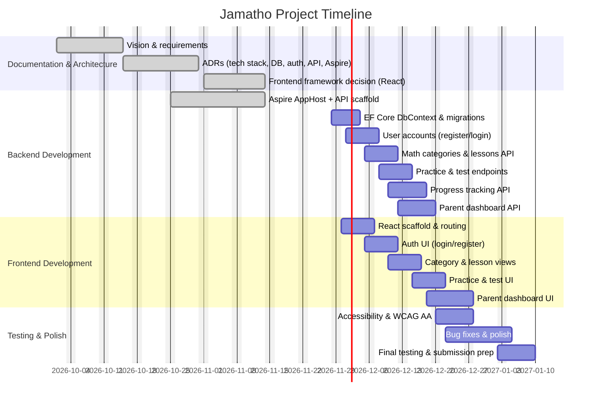

# Project Timeline — Jamatho

## Target Deadline

**January 10, 2027** — MVP release and university submission.

## Current Status (as of 2026-11-28)

- **Backend scaffold:** Complete — `Jamatho.Api`, `Jamatho.AppHost`, `Jamatho.ServiceDefaults` are in place. `dotnet run` in `Jamatho.AppHost` starts API + Postgres + pgAdmin together.
- **API endpoints:** Not implemented yet — controllers, services, DbContext, and EF Core migrations are still missing.
- **Frontend:** Not scaffolded — React decision recorded (ADR 0002), but no React project exists yet.
- **Database:** `Jamatho.Api/Migrations` folder is gitignored and currently empty — migrations must be generated with `dotnet ef migrations add`.

## Gantt Chart

## Roadmap Phases

| Phase | Timeline | Focus | Status |
|-------|----------|-------|--------|
| Phase 1 | Nov 28 – Dec 18, 2026 | MVP core: backend API (accounts, categories, lessons, practice, tests, progress) + frontend scaffold | In progress |
| Phase 2 | Dec 18, 2026 – Jan 05, 2027 | Polish, accessibility, bug fixes, more lessons per category | Upcoming |
| Phase 3 | Jan 05 – Jan 10, 2027 | Final testing, university submission, MVP release | Upcoming |

## Key Milestones

| Date | Milestone |
|------|-----------|
| 2026-10-01 | Vision, requirements, MVP, user stories documented |
| 2026-10-15 | ADRs 0001–0006 completed (tech stack, frontend, auth, DB, API style, Aspire) |
| 2026-11-14 | Backend scaffold initialized (.NET 9 API + Aspire AppHost + ServiceDefaults) |
| 2026-11-28 | Project status review — backend scaffold complete, endpoints not yet implemented |
| 2026-12-18 | Phase 1 complete: core backend API + frontend scaffold |
| 2027-01-05 | Phase 2 complete: polish, accessibility, bug fixes |
| 2027-01-10 | Final testing, university submission, MVP release |

## Notes

- Backend scaffold (`Jamatho.Api`, `Jamatho.AppHost`, `Jamatho.ServiceDefaults`) is complete; actual API controllers and EF Core migrations still need to be added.
- Frontend is not yet scaffolded; React was selected in ADR 0002 but no React project exists.
- `Jamatho.Api/Migrations` folder is gitignored and currently empty — migrations must be generated with `dotnet ef migrations add`.
- All dates are inclusive. Weekends are excluded from the Gantt chart working days.