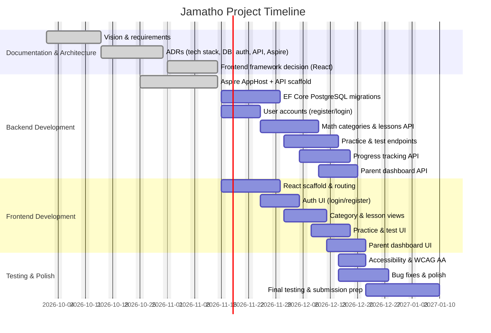

# Project Timeline — Jamatho

## Target Deadline

**January 10, 2027** — MVP release and university submission.

## Gantt Chart

## Roadmap Phases

| Phase | Timeline | Focus | Status |
|-------|----------|-------|--------|
| Phase 1 | Nov 14 – Nov 15, 2026 | MVP core: accounts, categories, lessons, practice, tests, parent dashboard | In progress / completing |
| Phase 2 | Nov 15 – Dec 15, 2026 | Polish, accessibility, bug fixes, more lessons per category | Upcoming |
| Phase 3 | Dec 15, 2026 – Jan 10, 2027 | Final testing, university submission prep | Upcoming |

## Key Milestones

| Date | Milestone |
|------|-----------|
| 2026-10-01 | Vision, requirements, MVP, user stories documented |
| 2026-10-15 | ADRs 0001–0005 completed (tech stack, frontend analysis, auth, DB, API style) |
| 2026-10-25 | Backend initialized: .NET 9 API + Aspire AppHost + ServiceDefaults |
| 2026-11-01 | Frontend framework analysis completed |
| 2026-11-14 | Frontend framework decision: **React** (ADR 0002 updated) |
| 2026-11-14 | Documentation aligned with backend (AGENTS.md, README, ADR 0004, ADR 0006) |
| 2026-11-14 | API documented and tested in Postman; OpenAPI available at /openapi.json in Development |
| 2026-11-30 | Backend API endpoints implemented (categories, lessons, practice, tests) |
| 2026-12-15 | Frontend MVP complete (React UI for all core flows) |
| 2026-12-22 | Accessibility (WCAG 2.1 AA) and bug fixes complete |
| 2027-01-10 | Final testing, university submission, MVP release |

## Notes

- All dates are inclusive.
- Weekends are excluded from the Gantt chart working days.
